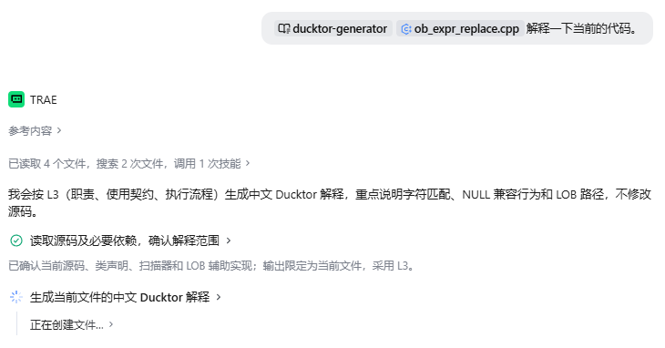
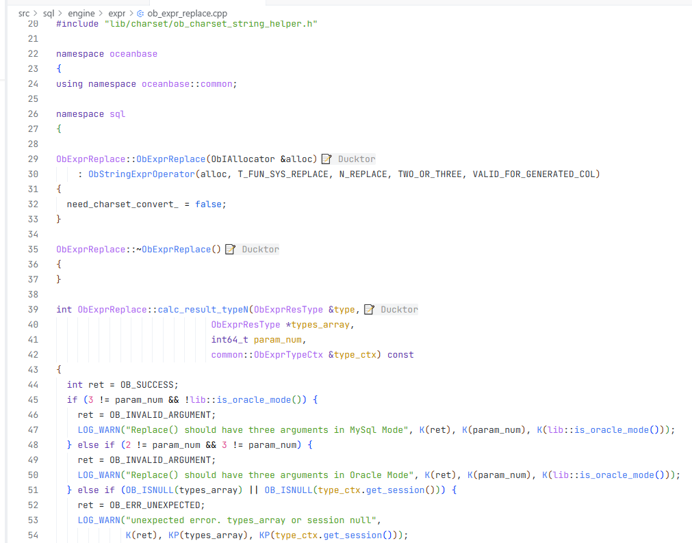
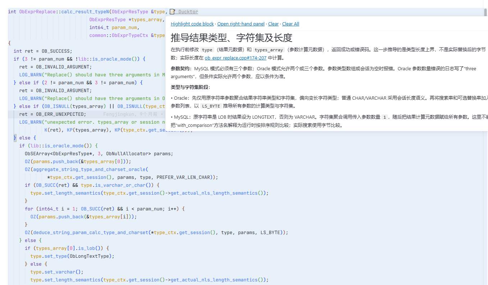
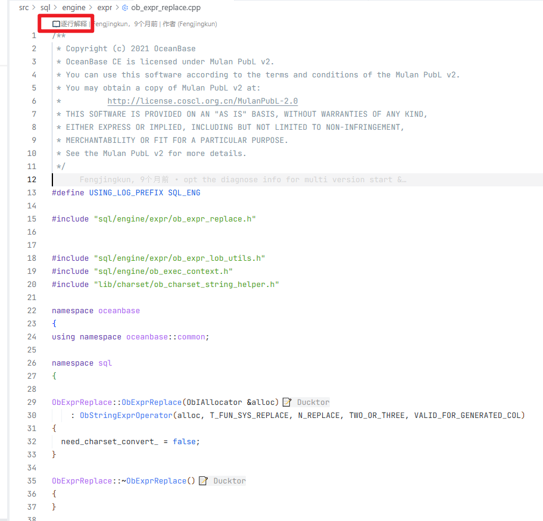
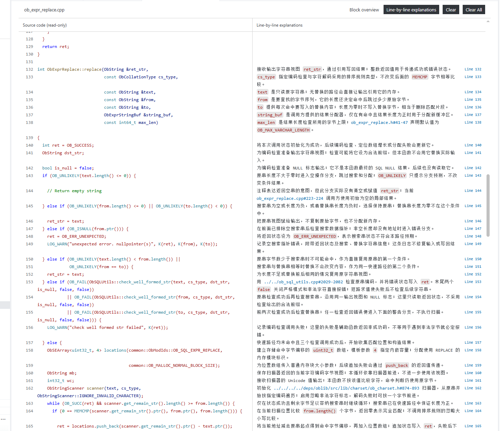

<p align="right">
  <a href="README.md">English</a> | <a href="README.zh-CN.md">中文</a>
</p>

# Ducktor

Ducktor: Use AI to generate code explanations and make reading easier with a VS Code extension.

## Overview

Ducktor stores code explanations in separate `.ducktor` files and displays them alongside source code in VS Code. It supports project onboarding, implementation walkthroughs, and code review without changing source code just to add explanations.

This repository contains two complementary components that can also be used independently:

| Component | Purpose | Entry point |
| --- | --- | --- |
| Ducktor Generator skill | Guides an AI agent to read source code and generate or update `.ducktor` files at a requested scope and depth | [SKILL.md](skills/ducktor-generator/SKILL.md) |
| Ducktor VS Code extension | Reads `.ducktor` files and displays block explanations, terms, and line-by-line previews | [Extension directory](vsc-plugin/) |

Workflow: **source code → AI + generator skill → `.ducktor` files → VS Code extension → reading and navigation**.

The extension is not an AI generator and does not require model or API-key configuration. Generation is handled by the AI host using the skill. You can also write `.ducktor` files manually and use only the extension.

## Features

- **Layered generation**: L1–L5 presets with independently configurable capabilities. Scope and depth are separate choices.
- **Block explanations**: Read an overview through an end-of-line hint on a block's first line, or in a right-hand panel.
- **Term definitions**: Dotted-underlined keywords reveal definitions on hover, with aliases and global, module, or local scopes.
- **Line-by-line reading**: A standalone tab aligns complete read-only source code on the left with Markdown explanations on the right, with an overall-explanation view available.
- **Connected references**: Navigate to source files, line ranges, workspace symbols, and external documentation.
- **Anchor-based positioning**: Function, class, text, and other anchors help relocate blocks, with line ranges as a fallback.
- **Bilingual interface**: English and Simplified Chinese notifications, diagnostics, and explanation panels. Explanation text follows the language requested during generation.

## Screenshots

### Generate explanations in Trae

Use the `ducktor-generator` skill with a source file to generate explanations at the requested depth.



### Code block hints

Ducktor adds end-of-line hints to explained blocks. This example shows OceanBase source code.



### Hover explanations

Hover over a Ducktor hint to read the block overview and follow references to related code.



### Open the line-by-line preview

When valid line explanations are available, use the CodeLens entry at the top of the source file to open the standalone preview.



### Read source and explanations side by side

The standalone preview aligns source code with detailed line explanations and links to related implementations.



## Quick start

### 1. Install the VS Code extension

Requires **VS Code 1.85.0 or later**.

The repository root includes [ducktor-0.1.18.vsix](ducktor-0.1.18.vsix). Run `Extensions: Install from VSIX...` in VS Code and select it, or run this from the repository root:

```sh
code --install-extension ./ducktor-0.1.18.vsix
```

Open the project folder you want to explore in VS Code, rather than opening only a standalone source file.

### 2. Load the generator skill

[skills/ducktor-generator](skills/ducktor-generator/) contains `SKILL.md` and its on-demand `references/`.

Place the **entire skill directory** in a location supported by your AI host, or ask the agent to read `SKILL.md` and follow its procedure. Copying only the entry file loses the format and generation references. The repository's `skills/` directory is a distribution location, not a universally auto-discovered installation path.

For example, Codex uses `.codex/skills/ducktor-generator/` for project-level skills. Follow the relevant skill-loading convention for other hosts.

#### Install with OpenSkills

[OpenSkills](https://github.com/numman-ali/openskills) installs skills from a GitHub repository or local path and copies the complete skill directory, including `references/`. Requires Node.js. Run these commands in the project where you want to use the skill:

```sh
# Install from GitHub (project-level, .claude/skills/)
npx openskills install ZoruaSama/Ducktor

# Or install globally (~/.claude/skills/)
npx openskills install ZoruaSama/Ducktor --global

# Or install to .agent/skills/ for non-Claude or multi-agent setups
npx openskills install ZoruaSama/Ducktor --universal

# Or install from a local clone of this repository
npx openskills install ./skills/ducktor-generator
```

Select `ducktor-generator` when prompted, or add `-y` to install without prompting. Then register the skill for agents that read `AGENTS.md`:

```sh
npx openskills sync
```

`sync` updates an existing `AGENTS.md`. Agents can then load the skill with `npx openskills read ducktor-generator`. To get the latest skill version later, run `npx openskills update ducktor-generator`. Use `npx openskills list` to check installed skills.

Example requests:

```text
Generate L3 Ducktor explanations for src/main.js in English, with verified references to related symbols.

Generate L5 explanations for the current function. Explain only the type members it uses, not the entire class.

Generate L4 + G explanations for functions affected by this change, focusing on line-by-line behavior and review concerns.
```

The skill reads current source code, verifies positions and references, and recursively creates the workspace-root `.ducktor` directory and required mirrored subdirectories when missing. Updates preserve valid content outside the requested scope.

### 3. Read explanations in source code

- In the default `hover` mode, hover over the Ducktor end-of-line hint on a block's first line or a dotted-underlined term.
- In `panel` mode, use end-of-line hints or term-hover links to read in the right-hand panel; explanation bodies are not shown in hovers.
- When a file has valid `lines` entries, use its top-of-file line-by-line CodeLens to open the standalone two-column preview.
- Click line numbers in the preview to return to and locate source code. Switch directly between overall and line-by-line explanations.

**Enable both Inlay Hints and Hover in VS Code** to see Ducktor's end-of-line hints and hover explanations or navigation links. In Settings, search for `Editor: Inlay Hints Enabled` and set it to `on`, then search for `Editor: Hover Enabled` and enable it. Alternatively, add the following to your settings JSON:

```json
{
  "editor.inlayHints.enabled": "on",
  "editor.hover.enabled": true
}
```

End-of-line hints require **Inlay Hints**, while hover content and links require **Hover**. Term underlines do not depend on Inlay Hints. The top-of-file line-by-line entry also requires **CodeLens** (`editor.codeLens: true`). If hints or hovers are missing, check whether workspace or language-specific settings override these options. The standalone preview is independent of `ducktor.displayMode` and can coexist with the right-hand panel.

## Generation depth

| Level | Name | Default content |
| --- | --- | --- |
| L1 | Overview | A: responsibilities and results |
| L2 | Usage | A + B: important inputs, outputs, prerequisites, side effects, and failure behavior |
| L3 | Understanding | A + B + C: execution stages, branches, and data flow |
| L4 | Line-by-line | A + B + C + D: explanations for every meaningful source line |
| L5 | Guided learning | A + B + C + D + E + F: necessary symbols, relevant type members, and collaboration |

**G: review concerns** is an independent switch, such as `L4 + G`. Custom combinations such as `L1 + E` and `L3 + E` are also supported.

L5 explains only members involved in the current function by default. It does not enumerate an entire class or recursively expand dependencies. Levels and capabilities are generation policies, **not YAML fields in `.ducktor` files**. See [Capabilities and levels](skills/ducktor-generator/references/capabilities.md) for the full policy.

## File layout and minimal example

Mirror the source path relative to the workspace root and append the `.ducktor` extension:

```text
my-project/
├── src/
│   └── main.js
└── .ducktor/
    └── src/
        └── main.js.ducktor
```

The extension reads mirrored files under the workspace-root `.ducktor/` directory, **not same-named files next to source code**. Each folder in a multi-root workspace maintains its own `.ducktor/` directory.

Given these three source lines in `src/main.js`:

```js
function greet(name) {
  return `Hello, ${name}!`;
}
```

The corresponding `.ducktor/src/main.js.ducktor` can contain:

```yaml
blocks:
  - range: "1-3"
    anchor:
      type: function
      name: greet
    content: |
      Return a greeting string using `name`, without modifying external state.
      See the return expression at [main.js#2].
    lines:
      - line: 1
        content: "Define the `greet` function with a `name` parameter."
      - line: 2
        content: "Build and return the greeting using a template literal."
terms:
  - symbol: name
    type: variable
    scope: local
    block: 1
    content: |
      The name supplied by the current caller, used to construct the greeting.
```

Key rules:

- Use **UTF-8 YAML**. New files have top-level `blocks` and `terms` lists; use `[]` for an unused list.
- `range` and `lines.line` use **1-based source line numbers**. A local term's `block` is a **1-based index into the original `blocks` list**.
- `content` provides the overall explanation. Optional `lines` entries appear **only in the standalone preview**.
- File references are relative to the **source file's directory**, not the `.ducktor` file's directory. `[main.js#2]` above targets line 2 of `src/main.js`.
- Anchors help relocate a block that moves as a whole; edits inside a block still require updating line-by-line positions.
- The extension does not generate, migrate, or maintain explanation paths when source files are renamed. The skill, user, or another external tool handles those operations.

See [Ducktor format specification v0.5](rules.md) for the complete format. The generator skill provides focused, on-demand references for [core format](skills/ducktor-generator/references/format-core.md), [Markdown and links](skills/ducktor-generator/references/markdown-links.md), [line explanations](skills/ducktor-generator/references/line-explanations.md), [terms and types](skills/ducktor-generator/references/terms.md), and [validation](skills/ducktor-generator/references/validation.md). These reference documents are currently written in Chinese.

## Extension settings and common commands

| Setting | Default | Purpose |
| --- | --- | --- |
| `ducktor.enabled` | `true` | Enable explanation display |
| `ducktor.language` | `en` | Interface language: `en` or `zh-CN` |
| `ducktor.displayMode` | `hover` | Overall-explanation display mode: `hover` or `panel` |

Example VS Code settings JSON:

```json
{
  "ducktor.enabled": true,
  "ducktor.language": "en",
  "ducktor.displayMode": "hover"
}
```

The language setting does not translate existing explanation content. Command titles and setting descriptions remain in English.

| Command palette title | Purpose |
| --- | --- |
| `Ducktor: Refresh Code Explanations` | Refresh explanations manually |
| `Ducktor: Show Explanation in Right-hand Panel` | Read explanations in the right-hand panel |
| `Ducktor: Open Line-by-line Preview` | Open the current file's line-by-line preview |
| `Ducktor: Clear Current Explanation File` | Delete the current source file's explanation file |
| `Ducktor: Clear All Explanation Files` | Delete workspace explanation files after confirmation |

**Clear commands delete files; they do not just hide explanations.** To temporarily disable display, set `ducktor.enabled` to `false`. The extension watches mirrored explanation files for creation, changes, and deletion. Refresh manually if the display is stale.

## Repository structure and development

```text
Ducktor/
├── README.md                     # English
├── README.zh-CN.md               # Chinese
├── rules.md                      # Complete file format specification
├── skills/
│   └── ducktor-generator/
│       ├── SKILL.md               # Generation procedure entry point
│       └── references/            # On-demand rules
├── vsc-plugin/
│   ├── package.json              # Extension metadata and scripts
│   ├── extension.js              # VS Code integration and interactions
│   ├── core.js                   # Parsing, positioning, and term matching
│   ├── rendering.js              # Markdown and preview rendering
│   ├── localization.js           # Interface localization
│   └── test/core.test.js          # Automated tests
└── ducktor-0.1.18.vsix            # Installation package included in this repo
```

Install **Node.js and npm**, then run these commands in `vsc-plugin/` in order:

```sh
npm ci
npm run check
npm test
npm run package
```

`check` validates JavaScript syntax, `test` runs Node.js tests, and `package` builds a VSIX using VSCE. Packaging requires a Node.js version compatible with the development dependencies.

To debug, **open `vsc-plugin/` as the VS Code workspace** and press `F5` using the included Extension Host launch configuration. Open a test project containing `.ducktor/` in the new window.

Questions and feedback: [GitHub Issues](https://github.com/ZoruaSama/Ducktor/issues).
