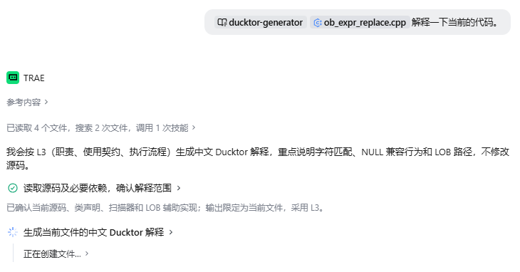
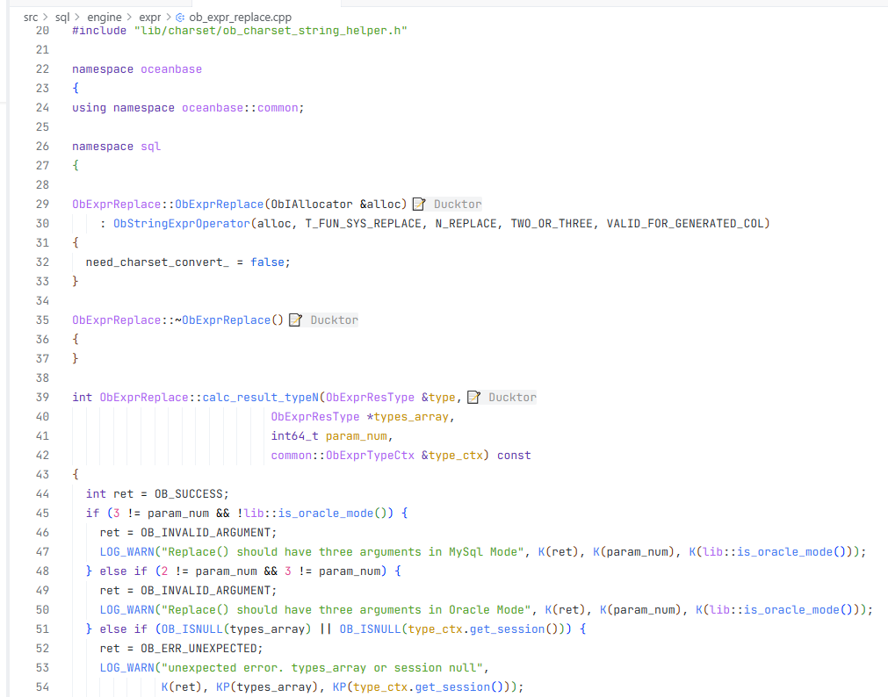
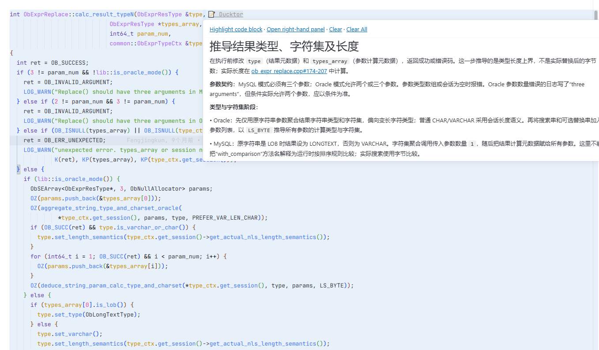
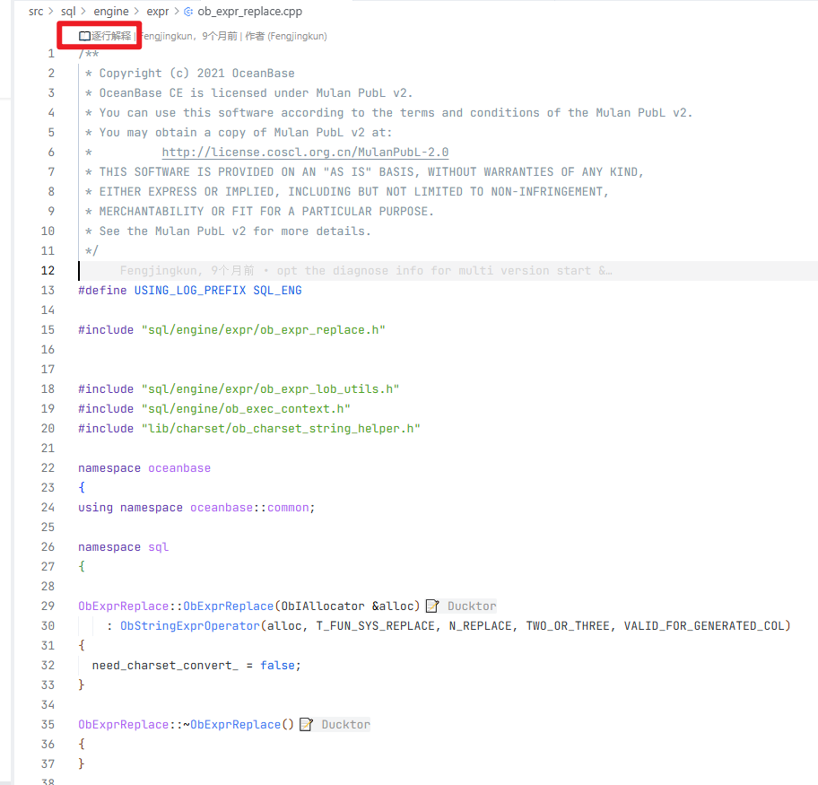
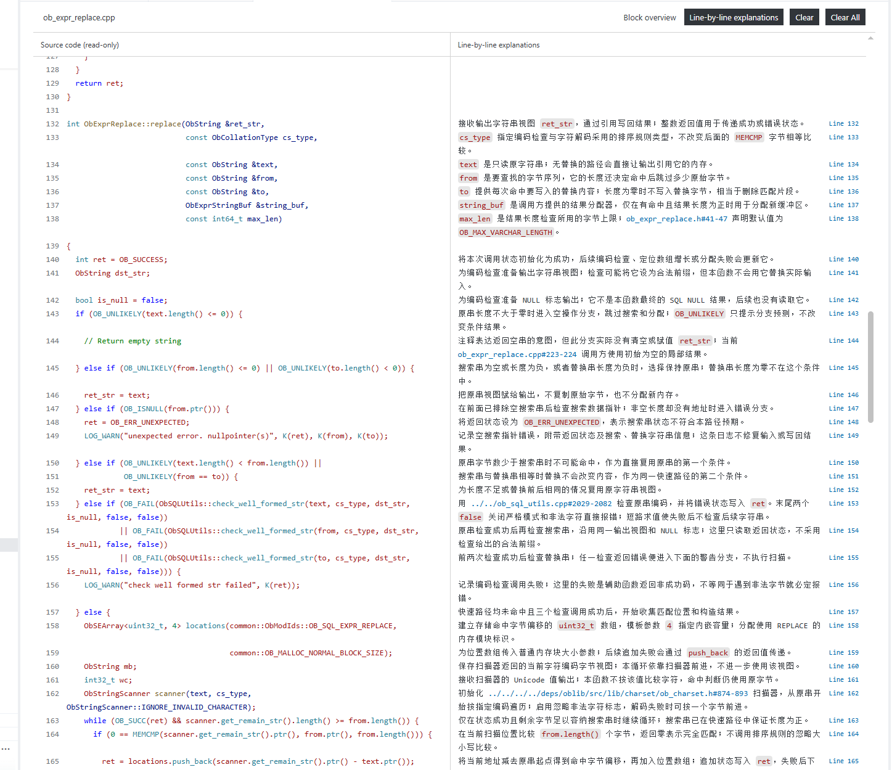
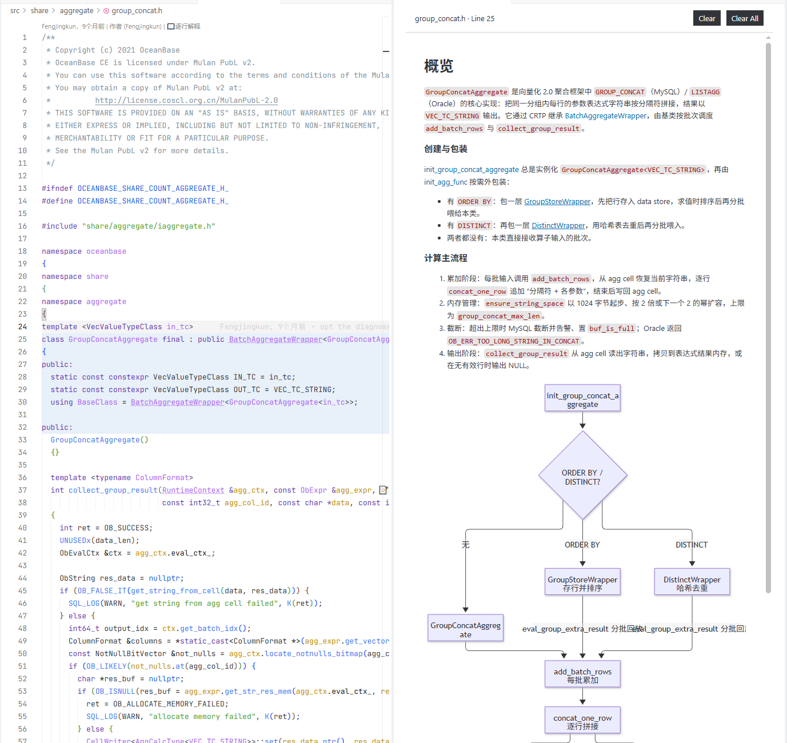

<p align="right">
  <a href="README.md">English</a> | <a href="README.zh-CN.md">中文</a>
</p>

# Ducktor · 小黄鸭博士

Ducktor: 用 AI 生成代码解释，用 vscode 插件让阅读更方便。

Ducktor = Duck + Doctor

## 项目简介

Ducktor 将代码解释保存为独立的 `.ducktor` 文件，再通过 VS Code 在源码旁展示。适用于陌生项目导读、实现理解和代码审阅，无需为解释修改源码。

本仓库包含两个互相配合、也可以独立使用的部分：

| 部分 | 作用 | 入口 |
| --- | --- | --- |
| Ducktor Generator skill | 指导 AI 阅读源码，按指定范围和深度生成或更新 `.ducktor` 文件 | [SKILL.md](skills/ducktor-generator/SKILL.md) |
| Ducktor VS Code 插件 | 读取 `.ducktor`，展示代码块解释、术语释义和逐行预览 | [插件目录](vsc-plugin/) |

工作流程：**源码 → AI + 生成 skill → `.ducktor` 文件 → VS Code 插件 → 阅读与跳转**。

插件不是 AI 生成器，不需要通过插件配置模型或 API Key；AI 生成由使用 skill 的宿主工具完成。你也可以手写 `.ducktor` 文件，仅使用插件阅读。

## 主要能力

- **分层生成**：L1–L5 深度预设，支持单独增减能力；生成范围与解释深度相互独立。
- **代码块解释**：通过代码块首行的行末提示查看整体说明，或在右侧面板阅读。
- **术语释义**：关键词显示点状下划线，悬停查看说明；支持别名与 global、module、local 作用域。
- **逐行阅读**：独立标签页中，左列展示只读完整源码，右列展示对应行的 Markdown 解释，并可切换整体说明。
- **引用串联**：解释中可链接源码文件、行范围、工作区符号及外部文档。
- **锚点定位**：支持函数、类、文本等锚点重定位，并以行范围兜底。
- **双语界面**：插件提示、诊断和解释面板支持英文与简体中文；解释正文语言由生成时的要求决定。

## 使用截图

### 在 Trae 中生成解释

将源码文件交给 `ducktor-generator` skill，按需要的深度生成代码解释。



### 代码块行末提示

Ducktor 会在已解释代码块的首行添加行末提示。下面以 OceanBase 源码为例。



### 悬停阅读整体说明

悬停 Ducktor 提示即可查看代码块整体说明，并通过引用跳转到相关源码。



### 打开逐行解释预览

存在有效逐行解释时，可通过源码文件顶部的 CodeLens 入口打开独立预览。



### 双列逐行阅读

独立预览将源码与详细逐行解释对齐展示，解释中可引用相关实现。



### 在右侧面板阅读图表

右侧解释面板通过 Mermaid 图表展示代码流程与协作关系，点击已绑定的节点可跳转到对应源码行范围。



## 快速开始

### 让 Agent 帮忙安装 skill 和插件

复制以下提示词到 Agent：

```text
请帮我安装 Ducktor skill 和 VSIX 插件，仓库：https://github.com/ZoruaSama/Ducktor。
1. 先检测操作系统及本机已安装的 VS Code 类 IDE（如 VS Code、Cursor、Qoder、Trae、CodeBuddy 等），列出名称、版本及可用的 CLI 或安装路径。
2. 询问我想给哪个或哪些 IDE 安装插件，以及使用哪个或哪些 Agent；等我确认后再安装。
3. skill 必须安装到用户主目录下的全局路径，不要安装到项目目录。完整复制 skills/ducktor-generator/，包含 SKILL.md 和 references/。Codex 用 ~/.codex/skills/ducktor-generator/，Claude Code 用 ~/.claude/skills/ducktor-generator/，Cursor 用 ~/.cursor/skills/ducktor-generator/。
4. 若使用 OpenSkills，先检查 Node.js/npm，按需安装 npm install -g openskills，再运行 openskills install ZoruaSama/Ducktor --global --universal，选择 ducktor-generator。确认 Agent 能加载 ~/.agent/skills/；不能自动加载时，使用其原生全局路径。后续更新用 openskills update ducktor-generator。
5. 从 GitHub Releases 下载最新发布的 VSIX，使用所选 IDE 实际支持的安装方式安装到当前用户的全局扩展目录，不要装到项目或其他 IDE。不要覆盖已有设置；新增依赖、提权或覆盖文件前先征求我确认。
6. 验证插件和完整 skill 已安装，报告实际路径及需要重启或重新加载的 IDE/Agent。不要声称尚未执行的步骤已成功。
7. 最后向用户输出以下使用提示：
按 Ctrl + Shift + P（macOS：⌘ + Shift + P）打开命令面板，直接搜索以下关键词，选择对应的切换命令并确保功能已开启：
hover：开启 Hover 悬浮提示。
codelens：开启 CodeLens。
inlay hints：开启 Inlay Hints 行内提示。
```

### 1. 安装 VS Code 插件

需要 **VS Code 1.85.0 或更高版本**。

下载 releases 的 vsix 文件，然后在 VS Code 命令面板运行 `Extensions: Install from VSIX...`，选择该文件。

安装后，用 VS Code 打开需要阅读的项目文件夹，而不只是单独打开一个源码文件。

Ducktor 暂未发布到插件商店，请使用 GitHub Releases。按 `Ctrl + Shift + P`（macOS：`⌘ + Shift + P`）打开命令面板，直接搜索 `hover`、`codelens`、`inlay hints`，选择对应的切换命令，并确保 Hover、CodeLens 和 Inlay Hints 已开启。也可以在命令面板运行 `Preferences: Open User Settings (JSON)`，将以下配置合并到现有设置，不要覆盖其他配置：

```json
{
  "editor.inlayHints.enabled": "on",
  "editor.hover.enabled": true,
  "editor.codeLens": true
}
```

### 2. 加载生成 skill

#### 使用 OpenSkills 安装

先安装 [Node.js LTS](https://nodejs.org/)（包含 npm），再安装 [OpenSkills](https://github.com/numman-ali/openskills) 和完整 skill：

```sh
npm install -g openskills
openskills install ZoruaSama/Ducktor --global --universal
```

出现提示时选择 `ducktor-generator`。`--global --universal` 安装到 `~/.agent/skills/`；仅加 `--universal` 仍是项目级安装。确认所选 Agent 能加载通用目录；不能自动加载时，使用上方对应 Agent 的原生全局路径。

后续从原始来源更新 skill，并查看安装列表：

```sh
openskills update ducktor-generator
openskills list
```

如 Agent 读取 `AGENTS.md`，可在对应项目运行 `openskills sync` 注册已全局安装的 skill。这只更新项目中的注册信息，不会把 skill 安装到项目目录。其他 Agent 遵循各自的加载约定。

#### 手动安装

生成入口位于 [skills/ducktor-generator](skills/ducktor-generator/)，其中包含 `SKILL.md` 和按需加载的 `references/`。

将**整个 skill 目录**（包含 `SKILL.md` 和 `references/`）复制到用户主目录（`~`）下对应 Agent 的全局 skill 路径，而不是项目目录：

- Codex：`~/.codex/skills/ducktor-generator/`
- Claude Code：`~/.claude/skills/ducktor-generator/`
- Cursor：`~/.cursor/skills/ducktor-generator/`

按 Agent 要求重启或重新加载；若未自动发现 skill，可让 Agent 读取克隆仓库中的 `skills/ducktor-generator/SKILL.md` 并遵循其流程。仓库中的 `skills/` 是分发目录，不是自动发现的安装路径。

示例请求：

```text
为 src/main.js 生成 L3 Ducktor 解释，使用中文，并为相关符号补充可核实的引用。

为当前函数生成 L5 解释；只解释该函数涉及的类型成员，不展开整个类。

为本次改动涉及的函数生成 L4 + G 解释，重点说明逐行行为和审阅关注点。
```

Skill 会读取当前源码、核对行号和引用，自行递归创建缺失的工作区根 `.ducktor` 及所需镜像子目录；更新时保留请求范围外的有效内容。

### 3. 在源码中阅读

- 默认 `hover` 模式：悬停代码块首行的行末 Ducktor 提示，或带点状下划线的术语。
- `panel` 模式：通过行末提示或术语悬停入口，在右侧面板阅读，不在 Hover 中显示解释正文。
- 文件包含有效的 `lines` 时：通过文件顶部的逐行解释 CodeLens，打开独立双列预览。
- 双列预览中点击行号可回到源码并定位；整体说明与逐行说明可直接切换。

**请在 VS Code 中同时开启 Inlay Hints（内联提示）和 Hover（悬停提示）**，才能看到 Ducktor 行末提示及悬停解释或跳转入口。在`Ctrl+Shift+P`设置中搜索 `Editor: Inlay Hints Enabled` 并设为 `on`，再搜索 `Editor: Hover Enabled` 并启用；也可以在设置 JSON 中添加：

```json
{
  "editor.inlayHints.enabled": "on",
  "editor.hover.enabled": true
}
```

行末提示依赖 **Inlay Hints**，悬停正文和链接依赖 **Hover**；术语下划线不依赖 Inlay Hints。顶部逐行解释入口还需要开启 **CodeLens**（`editor.codeLens: true`）。若提示仍未显示，请检查工作区或语言专属设置是否覆盖了这些选项。逐行预览不受 `ducktor.displayMode` 限制，可与右侧面板同时打开。


### 4. 打开 Ducktor 文件目录（Explorer）

按 `Ctrl+Shift+P`（macOS 为 `Cmd+Shift+P`）打开命令面板，搜索并运行 **Ducktor: Open File Explorer / 打开文件目录**。命令 ID 为 `ducktor.showIndex`。

独立页面按原始目录结构列出带有 Ducktor 解释的源码文件。展开文件可浏览 **逐行解释、代码片段、术语解析**；点击文件名或具体解释条目，跳转到原始源码及对应行。

搜索**仅匹配文件名**，不搜索目录路径或解释正文。逐行解释和图表均支持 **全部／有／无**筛选，两个筛选条件同时生效。点击 **刷新**可重新加载列表。

## 生成深度

| 等级 | 名称 | 默认内容 |
| --- | --- | --- |
| L1 | 概览 | A：职责与结果 |
| L2 | 使用 | A + B：补充重要输入输出、前提、副作用和失败行为 |
| L3 | 理解 | A + B + C：补充执行阶段、分支和数据流 |
| L4 | 逐行 | A + B + C + D：解释所有有意义的源码行 |
| L5 | 导学 | A + B + C + D + E + F：补充必要符号与当前涉及的类型成员、协作关系 |

**G：审阅关注点**是独立开关，例如 `L4 + G`。也可以使用 `L1 + E`、`L3 + E` 等自定义组合。

L5 默认只解释当前函数涉及的成员，不列出整个类，也不递归展开依赖树。等级与能力仅是生成策略，**不是 `.ducktor` 的 YAML 字段**。完整约定见 [能力与等级](skills/ducktor-generator/references/capabilities.md)。

## 文件布局与最小示例

解释文件镜像源码相对于工作区根目录的路径，并追加 `.ducktor` 扩展名：

```text
my-project/
├── src/
│   └── main.js
└── .ducktor/
    └── src/
        └── main.js.ducktor
```

插件只读取工作区根 `.ducktor/` 中的镜像文件，**不读取源码旁的同名解释文件**。多根工作区分别维护各自的 `.ducktor/`。

例如 `src/main.js` 有以下三行源码：

```js
function greet(name) {
  return `Hello, ${name}!`;
}
```

对应的 `.ducktor/src/main.js.ducktor` 可以写为：

```yaml
blocks:
  - range: "1-3"
    anchor:
      type: function
      name: greet
    content: |
      根据 `name` 返回问候字符串，不修改外部状态。
      返回表达式见 [main.js#2]。
    lines:
      - line: 1
        content: "定义接收 `name` 参数的 `greet` 函数。"
      - line: 2
        content: "使用模板字符串拼接问候语并返回。"
terms:
  - symbol: name
    type: variable
    scope: local
    block: 1
    content: |
      当前调用传入的称呼，用于构造问候字符串。
```

格式要点：

- 使用 **UTF-8 YAML**；新文件顶层包含 `blocks` 与 `terms`，未使用的列表写 `[]`。
- `range`、`lines.line` 使用从 **1 开始的源码行号**；local 术语的 `block` 是原始 `blocks` 列表的 **1 基编号**。
- `content` 是整体说明；`lines` 是可选逐行说明，**仅在独立预览页展示**。
- 文件引用相对于**源码文件所在目录**，不是 `.ducktor` 文件所在目录。上例 `[main.js#2]` 指向 `src/main.js` 第 2 行。
- 锚点能帮助代码块整体移动后重新定位，但块内部增删行后仍需更新逐行行号。
- 插件不负责生成、迁移或跟随源码重命名维护解释文件；这些操作由 skill、用户或其他外部工具完成。

完整格式见 [Ducktor 文件规范](rules.md)。生成 skill 将实用规则拆成按需加载的参考资料，包括 [核心格式](skills/ducktor-generator/references/format-core.md)、[Markdown 与引用](skills/ducktor-generator/references/markdown-links.md)、[逐行说明](skills/ducktor-generator/references/line-explanations.md)、[术语与类型](skills/ducktor-generator/references/terms.md) 和 [检查清单](skills/ducktor-generator/references/validation.md)。

## 插件设置与常用命令

| 设置 | 默认值 | 作用 |
| --- | --- | --- |
| `ducktor.enabled` | `true` | 启用解释显示 |
| `ducktor.language` | `en` | 界面语言，可选 `en` 或 `zh-CN` |
| `ducktor.displayMode` | `hover` | 整体解释显示方式，可选 `hover` 或 `panel` |

例如，在 VS Code 设置 JSON 中使用：

```json
{
  "ducktor.enabled": true,
  "ducktor.language": "zh-CN",
  "ducktor.displayMode": "hover"
}
```

界面语言设置不会翻译已有解释正文。命令标题和设置描述仍为英文。

| 命令面板标题 | 作用 |
| --- | --- |
| `Ducktor: Refresh Code Explanations` | 手动刷新解释 |
| `Ducktor: Show Explanation in Right-hand Panel` | 在右侧面板阅读解释 |
| `Ducktor: Open Line-by-line Preview` | 打开当前文件逐行预览 |
| `Ducktor: Clear Current Explanation File` | 删除当前源码对应的解释文件 |
| `Ducktor: Clear All Explanation Files` | 确认后删除工作区中的解释文件 |

**清除命令会删除文件，不只是隐藏显示。** 如仅需暂时关闭展示，请将 `ducktor.enabled` 设为 `false`。插件会监听镜像解释文件的创建、修改与删除；显示未更新时可手动刷新。

## 仓库结构与开发

```text
Ducktor/
├── README.md                     # English
├── README.zh-CN.md               # 中文
├── rules.md                      # 完整文件格式规范
├── skills/
│   └── ducktor-generator/
│       ├── SKILL.md               # 生成流程入口
│       └── references/            # 按需加载的规则
├── vsc-plugin/
│   ├── package.json              # 插件配置与脚本
│   ├── extension.js              # VS Code 集成与交互
│   ├── core.js                   # 解析、定位与术语匹配
│   ├── rendering.js              # Markdown 和预览渲染
│   ├── localization.js           # 界面本地化
│   └── test/core.test.js          # 自动化测试
└── ducktor-0.1.18.vsix            # 当前仓库提供的安装包
```

安装 **Node.js 与 npm**，在 `vsc-plugin/` 目录依次运行：

```sh
npm ci
npm run check
npm test
npm run package
```

`check` 检查 JavaScript 语法，`test` 运行 Node.js 测试，`package` 使用 VSCE 生成 VSIX。打包时需要满足开发依赖的 Node.js 版本要求。

调试时，用 VS Code **打开 `vsc-plugin/` 作为工作区**，按 `F5`，使用仓库提供的 Extension Host 启动配置，在新窗口打开含 `.ducktor/` 的测试项目。

问题与反馈：[GitHub Issues](https://github.com/ZoruaSama/Ducktor/issues)。
