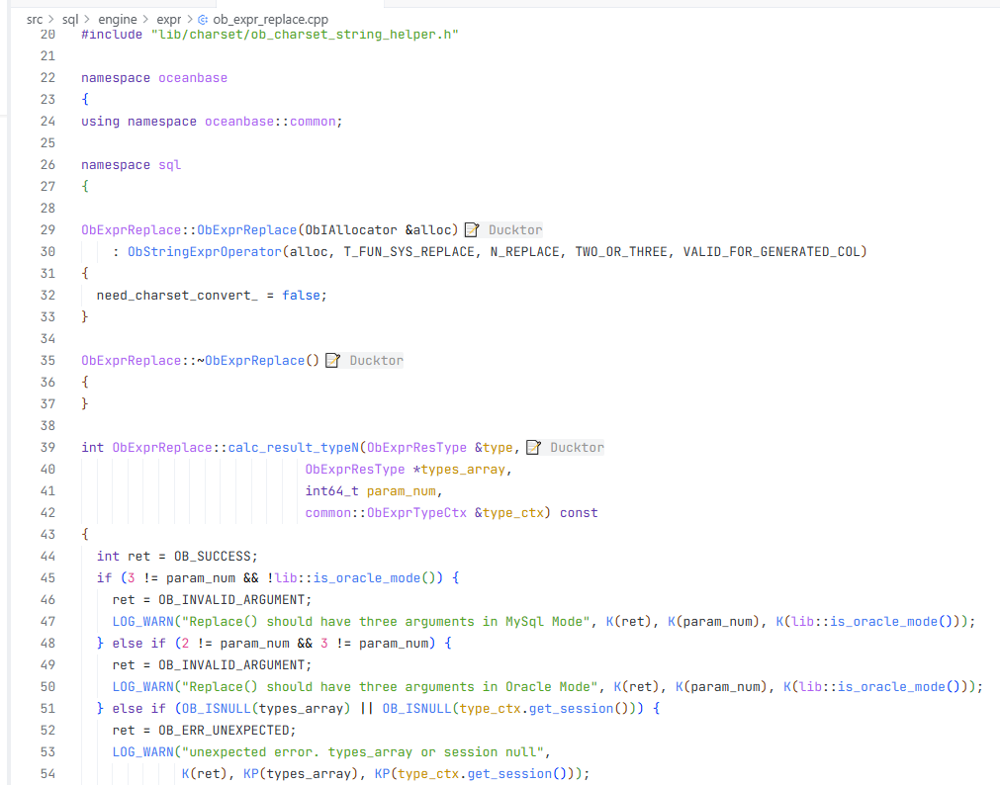
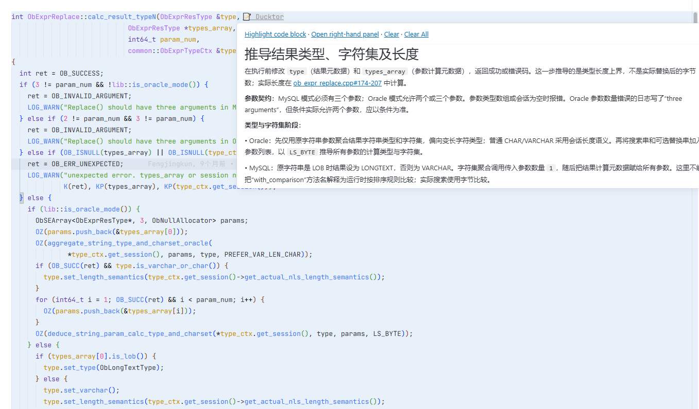
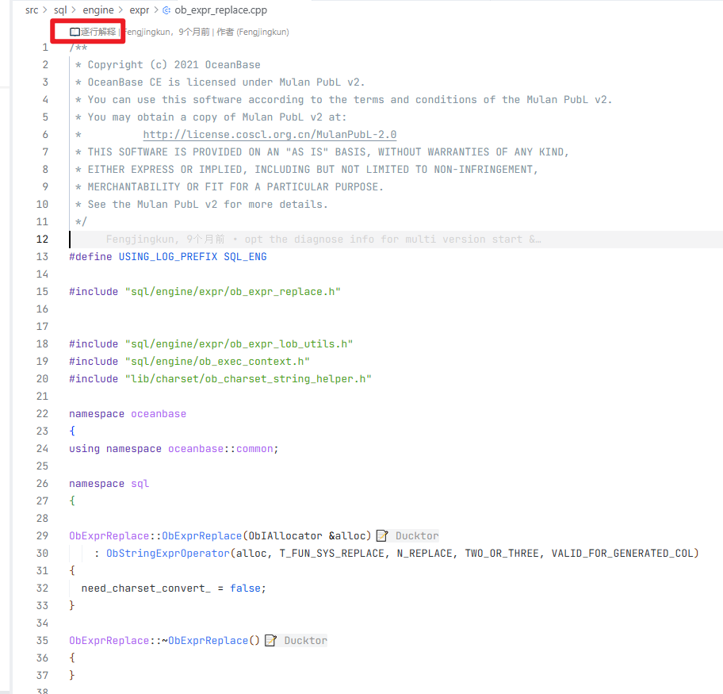
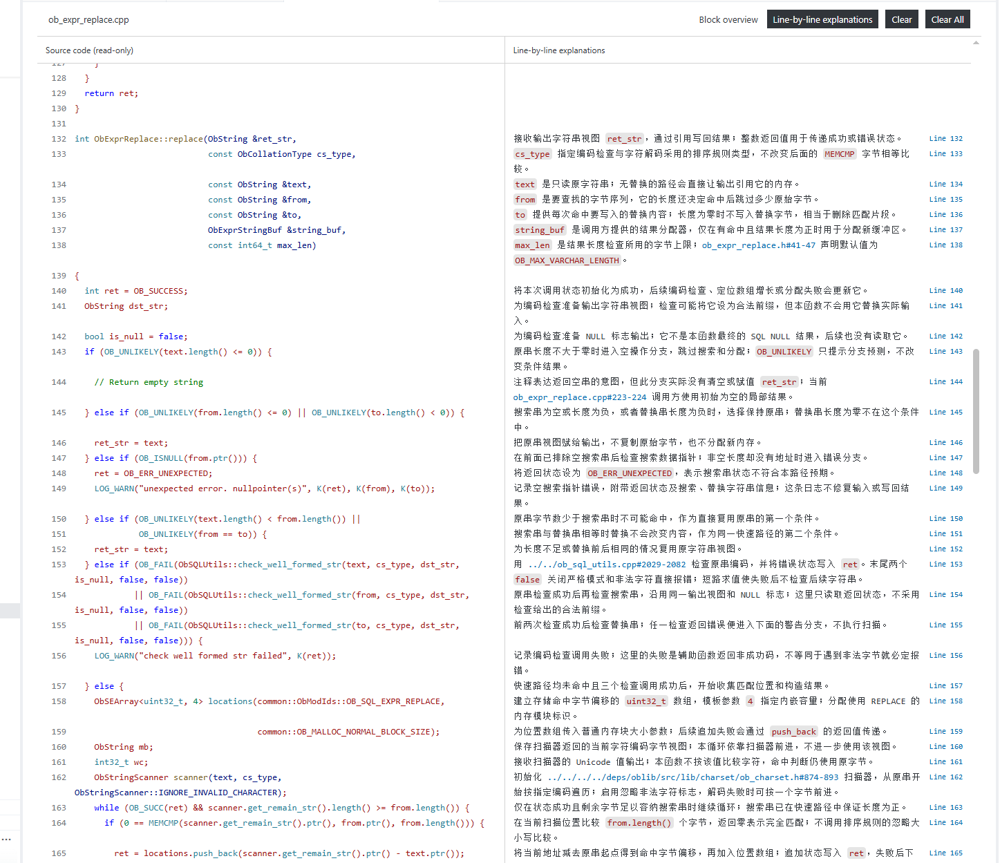

# Ducktor for VS Code

Read code explanations without adding explanatory comments to source code. Ducktor loads separate `.ducktor` files and presents block overviews, term definitions, and line-by-line explanations alongside your code.

The extension is a reader, **not an AI generator**. It does not require a model or API key. Write explanation files manually, or generate them with the [Ducktor Generator skill](https://github.com/ZoruaSama/Ducktor/tree/main/skills/ducktor-generator) using your AI host.

## Features

- **Block explanations** through end-of-line hints on a block's first line, with hover and right-hand panel display modes.
- **Term definitions** through dotted-underlined keywords, with aliases and global, module, or local scopes.
- **Line-by-line preview** in a standalone tab, aligning complete read-only source code with Markdown explanations. Switch between block overviews and line explanations.
- **Offline Mermaid diagrams** in the right-hand panel, with clickable flowchart and class nodes linked to source line ranges.
- **Connected references** to source files, line ranges, workspace symbols, and external documentation.
- **Anchor-based positioning** to relocate blocks when code moves, with source line ranges as a fallback.
- **English and Simplified Chinese UI** for notifications, diagnostics, hovers, and explanation panels.

## Screenshots

Examples below use OceanBase source code.

### Code block hints



### Hover explanations

Hover over a Ducktor hint to read the block overview and follow references to related code.



### Line-by-line preview entry

When valid line explanations are available, use the CodeLens entry at the top of the source file.



### Side-by-side reading

Read source code and detailed line explanations together, with links to related implementations.



## Quick start

### 1. Install and open a project

Requires **VS Code 1.85.0 or later**.

Download a VSIX from [GitHub Releases](https://github.com/ZoruaSama/Ducktor/releases), then run `Extensions: Install from VSIX...` in the VS Code command palette and select the file. Alternatively:

```sh
code --install-extension ./ducktor-0.1.18.vsix
```

Open the project folder you want to explore, rather than only a standalone source file.

### 2. Enable Inlay Hints, Hover, and CodeLens

**Enable both Inlay Hints and Hover** to see Ducktor's end-of-line hints and hover explanations or navigation links. Enable **CodeLens** for the top-of-file line-by-line preview entry.

In Settings, set `Editor: Inlay Hints Enabled` to `on` and enable `Editor: Hover Enabled` and `Editor: Code Lens`. Alternatively, use this settings JSON:

```json
{
  "editor.inlayHints.enabled": "on",
  "editor.hover.enabled": true,
  "editor.codeLens": true
}
```

Term underlines do not depend on Inlay Hints, but their hover content and navigation links require Hover. If hints or hovers are missing, check whether workspace or language-specific settings override these options.

### 3. Add explanation files

Mirror the source path relative to the workspace root and append `.ducktor`:

```text
my-project/
├── src/
│   └── main.js
└── .ducktor/
    └── src/
        └── main.js.ducktor
```

The extension reads files under the workspace-root `.ducktor/` directory, **not same-named files next to source code**. Each folder in a multi-root workspace maintains its own `.ducktor/` directory. Create these directories yourself or let an external generator create them.

### 4. Read and navigate

- In the default `hover` mode, hover over a Ducktor end-of-line hint on a block's first line or a dotted-underlined term.
- In `panel` mode, use end-of-line hints or term-hover links to read in the right-hand panel; explanation bodies are not shown in hovers.
- When a file has valid `lines` entries, use its top-of-file CodeLens or `Ducktor: Open Line-by-line Preview` to open the standalone preview.
- Click preview line numbers to return to and locate source code. Switch directly between block overviews and line explanations.

The standalone preview is independent of `ducktor.displayMode` and can coexist with the right-hand panel.

## File format and minimal example

Given these three lines in `src/main.js`:

```js
function greet(name) {
  return `Hello, ${name}!`;
}
```

Create `.ducktor/src/main.js.ducktor` with:

```yaml
blocks:
  - range: "1-3"
    anchor:
      type: function
      name: greet
    content: |
      Return a greeting string using `name`, without modifying external state.
      See the return expression at [main.js#2].
    lines:
      - line: 1
        content: "Define the `greet` function with a `name` parameter."
      - line: 2
        content: "Build and return the greeting using a template literal."
terms:
  - symbol: name
    type: variable
    scope: local
    block: 1
    content: |
      The name supplied by the current caller, used to construct the greeting.
```

Key rules:

- Use **UTF-8 YAML**, with top-level `blocks` and `terms` lists. Use `[]` for an unused list.
- `range` and `lines.line` use **1-based source line numbers**. A local term's `block` is a **1-based index into the original `blocks` list**.
- `content` provides the overall explanation. Optional `lines` entries appear **only in the standalone preview**.
- File references are relative to the **source file's directory**, not the explanation file's directory. `[main.js#2]` above targets line 2 of `src/main.js`.
- Anchors help relocate a block that moves as a whole; edits inside a block still require updating line-by-line positions.
- The extension does not generate, migrate, or maintain explanation paths when source files are renamed. A user, skill, or external tool handles those operations.

See the [Ducktor format specification v0.5](https://github.com/ZoruaSama/Ducktor/blob/main/rules.md) for the complete format; the specification is currently written in Chinese.

## Diagrams and clickable source nodes

Use a fenced `mermaid` block in block or term `content`. Supported examples include flowcharts, architecture/framework diagrams using flowchart `subgraph`, class diagrams, sequence diagrams, and state diagrams. PlantUML syntax is not supported.

Diagrams render **only in the right-hand explanation panel**. Hovers and the standalone line-by-line preview, including its overview tab, show the original Mermaid code. Diagrams in `lines[].content` are not rendered.

````yaml
blocks:
  - range: "1-30"
    content: |
      Request handling flow.

      ```mermaid
      flowchart LR
        subgraph Service
          Receive[Receive request] --> Validate{Valid?}
        end
        Validate -->|Yes| Execute[Execute handler]
        Validate -->|No| Reject[Return error]
        %% ducktor-link {"node":"Receive","target":"./handler.ts#3-8"}
        %% ducktor-link {"node":"Execute","target":"./service.ts#12-25"}
      ```
terms: []
````

- Each `%% ducktor-link` line contains strict JSON with a `node` ID and a `target` source path plus a **1-based line number or range**.
- Paths are relative to the explained source file's directory, not the `.ducktor` directory. Term diagrams use the source file declaring the term. Targets must resolve to files inside the workspace.
- Use Mermaid's explicit node ID, not its displayed label. IDs may contain ASCII letters, digits, underscores, and hyphens. A node can have one mapping per diagram; separate diagrams can reuse IDs.
- Click a mapped flowchart node or class, or focus it and press Enter/Space, to open and select the source range. Missing targets or unmatched IDs remain non-interactive. Sequence and state diagrams render, but source-node binding is not guaranteed for them.
- Rendering is offline. Native Mermaid `click`/`href`, configuration directives/frontmatter, HTML labels, images, and icon resources are disallowed. Use plain-text labels and Ducktor's controlled mappings instead.
- Invalid diagrams display an error and retain their code without preventing other content from rendering.

For class diagrams, use `classDiagram` and map the class ID, for example `%% ducktor-link {"node":"AuthService","target":"./auth.ts#10-40"}`.

## Settings

| Setting | Default | Purpose |
| --- | --- | --- |
| `ducktor.enabled` | `true` | Enable explanation display |
| `ducktor.language` | `en` | Interface language: `en` or `zh-CN` |
| `ducktor.displayMode` | `hover` | Overall-explanation display mode: `hover` or `panel` |

Example settings JSON:

```json
{
  "editor.inlayHints.enabled": "on",
  "editor.hover.enabled": true,
  "editor.codeLens": true,
  "ducktor.enabled": true,
  "ducktor.language": "en",
  "ducktor.displayMode": "hover"
}
```

The language setting does not translate existing explanation content. Command titles and setting descriptions remain in English.

## Common commands

| Command palette title | Purpose |
| --- | --- |
| `Ducktor: Refresh Code Explanations` | Refresh explanations manually |
| `Ducktor: Show Explanation in Right-hand Panel` | Read explanations in the right-hand panel |
| `Ducktor: Open Line-by-line Preview` | Open the current file's line-by-line preview |
| `Ducktor: Clear Current Explanation File` | Delete the current source file's explanation file |
| `Ducktor: Clear All Explanation Files` | Delete workspace explanation files after confirmation |

**Clear commands delete files; they do not just hide explanations.** To temporarily disable display, set `ducktor.enabled` to `false`.

The extension watches mirrored explanation files for creation, changes, and deletion. Use the refresh command if the display is stale.

## Development

Install Node.js and npm, then run these commands in the extension directory:

```sh
npm ci
npm run check
npm test
npm run package
```

`check` validates JavaScript syntax, `test` runs Node.js tests, and `package` builds a VSIX using VSCE. Use a Node.js version compatible with the development dependencies.

To debug, open `vsc-plugin/` as the VS Code workspace and press `F5` using the included Extension Host launch configuration. Open a test project containing `.ducktor/` in the new window.

## Feedback

For the generator skill and full project documentation, see the [Ducktor repository](https://github.com/ZoruaSama/Ducktor). Report questions or problems through [GitHub Issues](https://github.com/ZoruaSama/Ducktor/issues).
